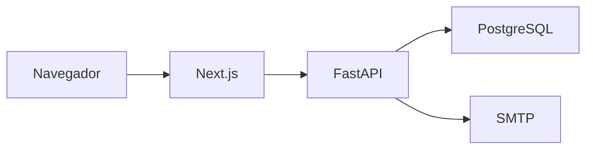

# Arquitetura da SSciX

## Arquitetura inicial

A SSciX usa um monólito modular. O Next.js App Router serve a interface responsiva e expõe um ponto de entrada HTTP da mesma origem em `/api/v1`. O FastAPI executa a lógica de contas e perfis, com SQLAlchemy para o acesso ao PostgreSQL e Alembic para migrações. O backend usa SMTP para confirmar endereços e recuperar contas. O Docker Compose liga os quatro serviços numa rede local e expõe a aplicação e a caixa de correio de desenvolvimento no loopback.

O encaminhador HTTP conserva os cookies e o cabeçalho `Origin`, restringe o tamanho dos pedidos JSON e lê o endereço do FastAPI em tempo de execução. As páginas públicas são renderizadas no servidor e consultam o estado atual do perfil. O contrato HTTP versionado fornece uma base para uma futura aplicação móvel. O cliente atual usa sessões de navegador. Uma aplicação móvel terá um fluxo de autenticação próprio quando for desenvolvida.

## Estrutura

| Caminho | Responsabilidade |
| --- | --- |
| `api/app/auth.py` | Registo, confirmação, recuperação, sessão e eliminação de conta |
| `api/app/profiles.py` | Consulta e edição do perfil, controlo de visibilidade e leitura pública |
| `api/app/security.py`, `mail.py` | Hashes, tokens, cookies, origem, limites de pedidos e SMTP |
| `api/app/models.py`, `schemas.py` | Persistência relacional e contratos validados |
| `api/migrations/` | Histórico de alterações do esquema |
| `api/tests/` | Testes de integração com PostgreSQL |
| `web/app/` | Páginas, formulários, estilos e encaminhamento da API |
| `web/e2e/` | Teste de navegador com Playwright |
| `compose.yaml` | Serviços locais e volume de dados |

## Modelo inicial

| Tabela | Chaves, índices e regras |
| --- | --- |
| `users` | UUID primário, email normalizado único, hash Argon2id, data de confirmação, versões e datas de aceitação de termos. A função de acesso é `user` por defeito e admite `moderator` e `admin` para evolução posterior. |
| `profiles` | UUID do utilizador como chave primária e estrangeira, com eliminação em cascata. O endereço público é único e a visibilidade é privada por defeito. O perfil guarda nome, função académica, instituição, país, cidade, especialização, interesses, biografia e ORCID. |
| `sessions` | Chave primária derivada por SHA-256 de um token aleatório. A chave estrangeira e a validade são indexadas. Cada sessão expira ao fim de sete dias. |
| `email_tokens` | Chave primária derivada por SHA-256, chave estrangeira e validade indexadas. A finalidade distingue confirmação (24 horas) de redefinição (30 minutos). Uma operação bem-sucedida invalida os links anteriores da mesma finalidade. |
| `rate_limits` | Chave composta pelo identificador derivado do limite e pela janela de dez minutos. A atualização atómica mantém o contador entre processos. |

A criação de conta e perfil ocorre na mesma transação. Se a entrega SMTP falhar após a gravação, o utilizador pode reenviar a confirmação. Confirmar email exige a palavra-passe usada no registo. A recuperação revoga todas as sessões. A eliminação da conta remove os dados que lhe pertencem por cascata de chaves estrangeiras.

A função académica é declarada pelo titular e separada da função de acesso. O ORCID tem validação de formato e dígito de controlo. Uma página pública inclui os campos do perfil quando o titular os publica. O email de acesso permanece privado.

## API inicial

Todos os caminhos abaixo usam o prefixo `/api/v1`. Os pedidos que alteram dados enviam `Origin` igual a `APP_ORIGIN` e usam JSON quando existe corpo. O esquema completo está em `/api/v1/openapi.json`.

| Método e caminho | Entrada e resultado |
| --- | --- |
| `GET /health` | 200 se a API consegue consultar o banco de dados |
| `POST /auth/register` | `email`, `name`, `slug`, `password`, `accept_terms`. 202 e envio do link |
| `POST /auth/resend` | `email`. 202 e reenvio para contas elegíveis |
| `POST /auth/verify` | `token`, `password`. 204 após confirmar |
| `POST /auth/login` | `email`, `password`. 204 com cookie de sessão |
| `POST /auth/logout` | Cookie de sessão quando presente. 204 após terminá-la |
| `POST /auth/forgot-password` | `email`. 202 e envio do link para contas elegíveis |
| `POST /auth/reset-password` | `token`, `password`. 204 após redefinir |
| `DELETE /auth/account` | Sessão ativa e `password`. 204 após eliminar |
| `GET /profiles/me` | Sessão ativa. 200 com os dados do próprio perfil |
| `PUT /profiles/me` | Sessão ativa e representação do perfil sem email. 200 com os dados guardados |
| `GET /profiles/{slug}` | 200 com dados públicos; 404 para endereços privados ou inexistentes |

Os cookies de sessão usam `HttpOnly` e `SameSite=Lax`. Quando `APP_ORIGIN` usa HTTPS, o cookie é `Secure` e tem prefixo `__Host-`. As respostas da API usam `Cache-Control: no-store`. O servidor confere a origem dos pedidos mutáveis e limita ações de autenticação por operação e, quando aplicável, por conta. Como o proxy local não encaminha o IP externo, os limites por origem de rede incidem sobre o próprio proxy. A implementação segue as referências da OWASP para [armazenamento de palavras-passe](https://cheatsheetseries.owasp.org/cheatsheets/Password_Storage_Cheat_Sheet.html) e [proteção contra CSRF](https://cheatsheetseries.owasp.org/cheatsheets/Cross-Site_Request_Forgery_Prevention_Cheat_Sheet.html).

## Plano de implementação

| Etapa | Entrega e critério para avançar |
| --- | --- |
| 1. Fundação | Conta, autenticação, primeiro perfil, migração e execução local. Validar persistência, confirmação, revogação de sessões e visibilidade. |
| 2. Perfis e rede | Completar os campos académicos. Implementar seguidores, bloqueio, silenciamento, instituições e pesquisa. Testar a aplicação da privacidade a todas as consultas. |
| 3. Feed académico | Adicionar publicações, comentários, reações e marcadores. Validar permissões e consistência nas operações concorrentes. |
| 4. Comunidades | Criar adesão pública, aprovada ou por convite, debates encadeados e denúncias. Testar as regras de participação por comunidade. |
| 5. Colaboração | Criar projetos, convites, documentos, mensagens e notificações com autorização por recurso. |
| 6. Administração e lançamento | Adicionar operações de moderação e registos de auditoria, SMTP de produção, HTTPS, backups com teste de restauro, limites no perímetro, CI e regras de indexação. A versão local mantém os perfis públicos fora da indexação. |
| 7. Descoberta e móvel | Medir a pesquisa textual antes de adicionar pesquisa semântica ou OpenSearch. Introduzir recomendações explicáveis, traduções em inglês e francês e preparar o cliente móvel. |

Publicações, seguidores, comunidades, debates e colaborações pertencem às etapas seguintes. A ligação ao Sussurros do Saber é editorial nesta versão e aparece na página inicial. A partilha de autenticação e os domínios de produção ficam para a integração de lançamento.
